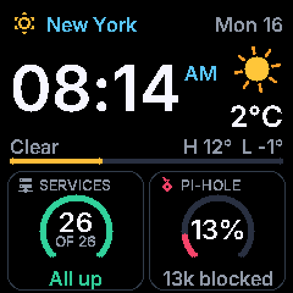
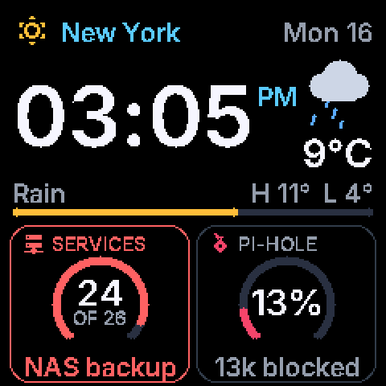
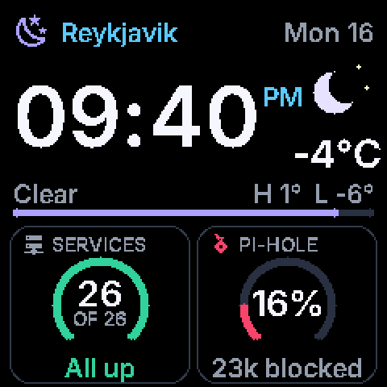
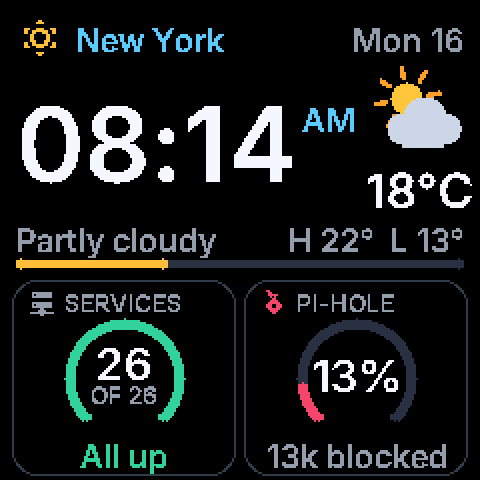
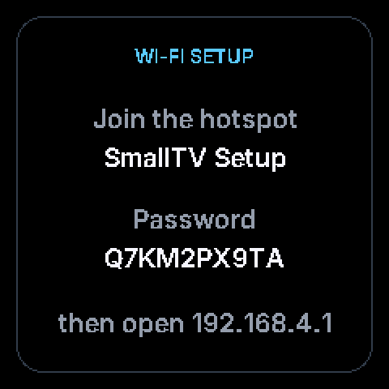
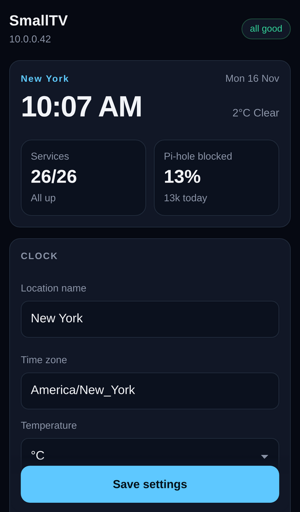
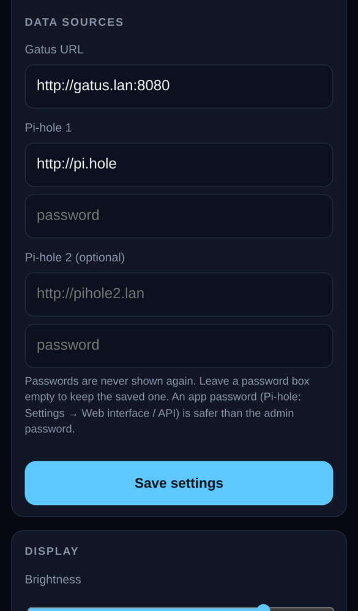

# smalltv-homelab

<p align="center">
  
</p>

ESPHome firmware that turns a cheap ESP8266 "SmallTV" / "Smart Weather Clock"
desk display (240×240 colour screen) into a homelab status screen:

- **World clock** for any city, with daylight saving handled on the device
- **Weather** from [Open-Meteo](https://open-meteo.com/) (no API key), with an
  animated icon: turning sun, twinkling stars, drifting clouds, rain, snow, lightning
- **Service health** from [Gatus](https://github.com/TwiN/gatus): a green ring
  when everything is up, a red card naming whatever is down
- **Pi-hole v6** queries blocked today, summed across one or two Pi-holes
- **Phone-friendly settings page** served by the device itself: no app, no
  Home Assistant, nothing loaded from the internet

Everything is configured from the web page. Nothing about your network is
compiled into the firmware.

## Screenshots

These come from the real drawing code (`include/screen.h`), rendered on a PC
with demo data. See [Preview on your PC](#preview-on-your-pc).

| All services up | Something down | Night |
|:---:|:---:|:---:|
|  |  |  |

**Animated weather icons:** sun, partly cloudy, cloudy, rain, snow, thunderstorm, fog.

<p align="center">
  
</p>

**First start:** before Wi-Fi is set up, the screen shows the setup hotspot and its password.

<p align="center">
  
</p>

### Settings page (on a phone)

| Status | Data sources |
|:---:|:---:|
|  |  |

## Hardware

Tested on an ESP8266 "Smart Weather Clock" clone of the GeekMagic SmallTV
(stock web page titled *Smart Weather Clock*, GIF themes, RGB LED controls).
The same ESPHome pins are used by the GeekMagic SmallTV Ultra.

| Part | Detail |
|---|---|
| MCU | ESP8266EX, 4 MB flash |
| USB | USB-C with a CH340 USB-serial chip, so it flashes over the cable, no soldering |
| Display | ST7789V 240×240, SPI, no CS pin |
| Pins | CLK `GPIO14`, MOSI `GPIO13`, DC `GPIO0`, RST `GPIO2`, backlight `GPIO5` (inverted PWM) |

If your unit's USB-C port is power only, you need to open the case and use the
serial pads instead.

## Install

You need Python 3 and [ESPHome](https://esphome.io/) (`pip install esphome`).

1. **Back up the stock firmware first.** With the display plugged in by USB:
   ```sh
   esptool --port /dev/ttyUSB0 read_flash 0 0x400000 stock-backup.bin
   ```
   Keep this file private: it contains your Wi-Fi name and password.
   You can always go back with `esptool --port /dev/ttyUSB0 write_flash 0 stock-backup.bin`.
2. Create your secrets file and set two random passwords:
   ```sh
   cp secrets.example.yaml secrets.yaml
   ```
3. Optionally change the defaults at the top of `smalltv.yaml` (city, time zone,
   weather location). All of them can also be changed later on the web page.
4. Flash over USB the first time:
   ```sh
   esphome run smalltv.yaml --device /dev/ttyUSB0
   ```
   Later updates go over Wi-Fi: `esphome run smalltv.yaml --device <device-ip>`.

## First start

1. The screen shows **Wi-Fi setup** with a hotspot name and password.
2. Join the **SmallTV Setup** hotspot from your phone and open `192.168.4.1`.
3. Pick your Wi-Fi network (2.4 GHz) and enter its password.
4. The screen restarts and shows its IP address. Open `http://<device-ip>/`.

## Settings page

| Setting | Notes |
|---|---|
| Location name | Typing a new city looks it up (Open-Meteo geocoding, from your phone's browser) and sets the weather location and time zone |
| Time zone | Search 300+ zones, or paste a POSIX rule such as `IST-5:30` |
| Temperature | °C or °F, shown after the number on the screen |
| NTP servers | Up to three, comma separated; empty uses `pool.ntp.org` |
| Gatus URL | e.g. `http://gatus.lan:8080`; the endpoint list must be readable without login |
| Pi-hole 1 / 2 | URL and password. An [app password](https://docs.pi-hole.net/api/auth/) is better than the admin password |
| Brightness | Backlight level |

Tap **Save settings** to keep changes. They are stored in their own 4 KB flash
sector (2 MB into the chip), so they survive power cuts and firmware updates.

The same values are exposed as ESPHome entities, so Home Assistant can read
the sensors if you add the `api:` component.

## How it works

- `include/homelab_status.h`: Gatus and Pi-hole clients (stream-parsed with
  ArduinoJson filters, so a Gatus with many endpoints still fits in RAM),
  the settings store, a POSIX time zone parser, NTP switching, and drawing helpers.
- `include/weather_icon.h`: Open-Meteo client and the animated icon. The icon is
  drawn into a 48×48 buffer and pushed straight to the panel five times a second,
  so the rest of the screen is not redrawn.
- `include/screen.h`: draws the whole screen from a plain data struct, shared by
  the device and the PC preview.
- `common/assets.yaml`: fonts and icons, shared the same way.
- `web/`: the settings page (plain JS and CSS, embedded in the firmware).
- `tools/gen_zones.py`: rebuilds the time zone table in `web/app.js` from tzdata.

## Preview on your PC

`preview/preview.yaml` builds the same screen for Linux with ESPHome's `host`
platform and an SDL window, filled with demo data:

```sh
sudo apt install libsdl2-dev
SCENE=ok esphome run preview/preview.yaml     # also: down, night, setup, weather
```

`tools/capture_screens.sh` regenerates every image above (needs Xvfb, ffmpeg,
ImageMagick and gifsicle).

## Security notes

- The settings page has no login. Anyone on your network can change settings
  through it or its REST API. Keep the display on a trusted network, or add
  `auth:` under `web_server:`.
- Passwords are stored unencrypted in the device's flash. Anyone with physical
  access and a USB cable can read them, so prefer a Pi-hole **app** password.
- The page never shows saved passwords again.
- HTTPS sources are accepted but certificates are not checked (the ESP8266
  cannot verify them). Plain HTTP on your LAN is the expected setup.

## Credits

Layout ideas from the community:
[GeekMagic SmallTV Ultra ESPHome dashboard](https://community.home-assistant.io/t/geekmagic-smalltv-ultra-live-home-assistant-dashboard-clock-weather-solar-alarm-lights-via-esphome/1024513),
[geekmagic-hacs](https://github.com/adrienbrault/geekmagic-hacs),
[ESPHome devices: GeekMagic Ultra](https://devices.esphome.io/devices/geekmagic-ultra/).
Weather data by [Open-Meteo](https://open-meteo.com/) (CC BY 4.0).
Icons from [Material Design Icons](https://pictogrammers.com/library/mdi/).

## License

MIT
